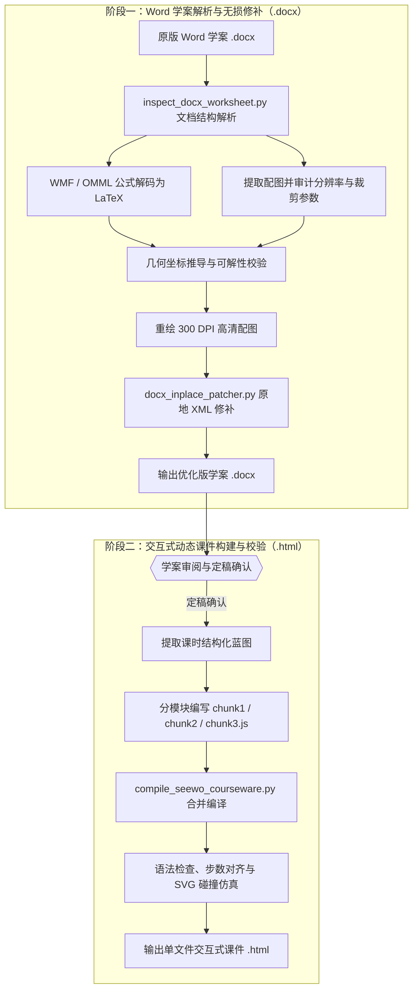

# 数学交互式课件（Math Interactive Courseware）

[](LICENSE)
[](https://www.python.org/)
[]()

> 面向中学数学课堂教学、希沃（Seewo）白板大屏及触屏设备的学案优化与交互式课件构建工具链。支持从 Word 学案原地 XML 无损修补（`.docx`）到单文件 SVG 动态交互课件（`.html`）的标准化构建与校验。

---

## 目录
- [一、系统架构与构建流程](#一系统架构与构建流程)
  - [阶段一：Word 学案解析与无损修补（.docx）](#阶段一word-学案解析与无损修补docx)
  - [阶段二：交互式动态课件构建与校验（.html）](#阶段二交互式动态课件构建与校验html)
- [二、自适应页面版式体系（Layouts A–E）](#二自适应页面版式体系layouts-ae)
- [三、几何图示 SVG 动态标注规范](#三几何图示-svg-动态标注规范)
- [四、渐进式呈现与教学节奏控制规范](#四渐进式呈现与教学节奏控制规范)
- [五、工具链接口与命令行使用说明](#五工具链接口与命令行使用说明)
- [六、项目目录结构](#六项目目录结构)

---

## 一、系统架构与构建流程

本项目采用**两阶段解耦构建流程**：先完成 Word 学案的结构解析、配图重绘与 XML 无损修补，经审阅定稿后，再以定稿学案为唯一数据源生成对应的单文件交互式 HTML 课件，确保学案与课件的题干、符号及图形坐标完全一致。



### 阶段一：Word 学案解析与无损修补（.docx）
1. **文档解析与公式解码**：
   - 运行 `inspect_docx_worksheet.py` 扫描文档 XML 结构；
   - 将遗留 MathType `<w:object>`（WMF 矢量对象）与原生 `<m:oMath>` 自动解码为内联 `$LaTeX$` 表达式；
   - 导出文档内的几何与函数配图，审计原始分辨率、物理尺寸及 `<a:srcRect>` 裁剪参数。
2. **几何坐标推导与可解性校验**：
   - 除自由动点（如 $A(x_0, k/x_0)$）外，垂足、交点、对称点坐标均由题干几何条件对应的代数方程精确计算，不引入无约束常数坐标；
   - 对含参面积或长度问题进行代数消元检验，确保结果唯一可解；
   - 校验题干几何元素名称与配图顶点字母完全对应。
3. **原地无损 XML 修补（In-Place XML Patching）**：
   - 调用 `docx_inplace_patcher.py` 在原文档 `word/document.xml` 上执行定点替换；
   - 完整保留原模板的页面边距、页眉、字号（四号 12pt）与行距（1.5 倍行距）；
   - 同步更新 `<mc:AlternateContent>` 浮动文本框的 DrawingML 与 VML 双分支，并清理文本框下方被遮挡的残留段落。
4. **定稿确认**：
   - 输出 `xxx_学生学案_优化版.docx` 及修订说明，确认定稿后进入课件构建阶段。

### 阶段二：交互式动态课件构建与校验（.html）
1. **数据源对齐**：
   - 以定稿学案中的题干、设问梯度、顶点字母与配图坐标作为唯一基准数据。
2. **模块化脚本编写**：
   - 按教学环节划分为 3 个脚本模块：
     - `chunk1_intro_explore.js`：情境引入与新知探究；
     - `chunk2_apply.js`：新知应用与典例精析；
     - `chunk3_train_summary.js`：分层训练与课堂小结。
   - 统一调用壳层接口：`window.defineSlide({...})`、`window.createCoordCanvas({...})`、`window.renderMultiPanelScene(step, panels)`。
3. **编译与自动化校验**：
   - 运行 `compile_seewo_courseware.py` 注入交互壳层并执行自动化校验：
     - JavaScript 语法检查；
     - 步骤一致性校验（`.step` 卡片数与进度圆点数、填空 `data-step` 严格对齐）；
     - DOM 与公式排版校验（根式顶线 `.sqrt`、二维叠置分式 `.fraction`、禁止嵌套 `<svg>`）；
     - SVG 文本与图形包围盒防重叠碰撞检测；
     - 全页面 `0..maxStep` 步进状态无头运行时仿真。

---

## 二、自适应页面版式体系（Layouts A–E）

为适配希沃一体机（16:9，推荐标准画布 1600×900）以及平板触控，课件内置 5 种响应式页面版式：

| 版式类型 | 适用题型与场景 | 页面结构与设计规范 |
| :--- | :--- | :--- |
| **版式 A (`layout-a`)** | **纯代数运算、概念辨析、无配图题** | **100% 全宽流式居中**：无右侧图形区，推导步骤卡片居中展示，字号适度放大，保证后排学生清晰可见。 |
| **版式 B (`layout-b`)** | **单配图几何/函数探究、综合大题** | **严格黄金分割“左解右图”**：左侧 `.screen-notes` 纵向流式排布步骤卡片，右侧 `.screen-media` 全高展示动态交互坐标系或几何图形。 |
| **版式 C (`layout-c`)** | **含 4 个图象选项的选择题** | **上题干与选项图矩阵 + 下解析**：顶部展示题干及一行 4 张高清晰度 SVG 图象卡片，支持点击选项即时判定，下方展示分步排除推导。 |
| **版式 D (`layout-d`)** | **列表—描点—连线作图探究题** | **上表格 + 左下解析 + 右下交互坐标系**：顶部展示标准取点表格，点击“下一步”时数值动态填入，右侧坐标系同步完成“描点 $\to$ 平滑曲线连接”。 |
| **版式 E (`layout-e`)** | **多点坐标验算/卡片翻转题** | **上题干 + 下多卡片网格**：下方并列展示待验算点卡片，跟随步骤逐张翻开并高亮判定结果。 |

---

## 三、几何图示 SVG 动态标注规范

课件中的几何图形完全采用原生高保真 SVG 动态生成，达到与出版级纸质讲义一致的清晰度与专业度：

1. **顶部通栏色彩图例条（`window.svgLegendBar`）**：
   - 凡涉及辅助线、特殊角弧、相似/全等阴影，画布顶部（$y=6\sim 36$）统一渲染浅灰圆角图例条；
   - 严禁在图形角落堆叠大块悬浮卡片遮挡几何边线，严禁在底部放置遮挡顶点的图注标题。
2. **数字角（`1, 2, 3, 4, 5`）图文联动（`window.svgNumberedAngle`）**：
   - 严禁绘制无文字空角弧，严禁使用冗长的三字母角名（如 $\angle DAH$）；
   - 统一在角平分线处以纯数字 $\angle 1, \angle 2, \dots$ 标注；
   - 共顶点相邻角采用**阶梯递增半径**（如 $r = 26, 33, 40$）错开；狭窄角自动开启 `leader: true` 细引线；
   - 左侧推导卡片 100% 同步使用 $\angle 1 = \angle 2$ 书写推导。
3. **求解目标引线气泡框（`window.svgCalloutTag`）**：
   - 在所求目标线段或角旁，采用带圆点引线的圆角标签框标注；
   - 推导中途显示绿底白字 `求 BC = ?`，最终步（`step === maxStep`）高亮切换为红底白字 `BC = 4√3`。
4. **全等/等腰双重标注**：
   - 相等边长必须标注法向垂直短杠（第一组标 `/`，第二组标 `//`）；
   - 已知边长及转移后的等量，紧贴线段标出数值（如 `4`）。
5. **视觉渲染层级**：
   $$\text{底层柔和三角形色块} \longrightarrow \text{原题实线与辅助虚线} \longrightarrow \text{角弧/短杠/直角标} \longrightarrow \text{顶层顶点圆点/斜体字母/图例条}$$
6. **图内公式二维上下叠置分式规范（严禁单行斜杠 `/` 拼凑）**：
   - 设元边长（如 $NF = \frac{4}{3}(4-x)$、$BF = \frac{25-4x}{3}$）及模型比例（$\frac{PF}{PE} = \frac{4}{3}n$），一律调用 `window.svgFoLabel` 或在 `<foreignObject>` 中以 `.fraction` 渲染标准叠置分式，严禁在 `<text>` 中单行裸写 `4/3(4-x)` 或 `(25-4x)/3`；
   - 编译脚本内置 `BARE SLASH FRACTION IN SVG TEXT DETECTED` 语法门禁进行强制校验拦截。

---

## 四、渐进式呈现与教学节奏控制规范

1. **初始状态（`step = 0`）留白控制**：
   - 进入页面时，所有推导步骤卡片默认隐藏，填空处保持留白；
   - **坐标系初始状态**：对于原学案无配图、课件补充坐标系的题目，`step = 0` 时右侧**仅展示空白坐标轴与网格**，严禁提前画出双曲线或描出关键点；
   - **几何图初始状态**：`step = 0` 严格还原原题，辅助线与色块在对应步骤触发时动态生长。
2. **定性观察与禁用动态测量读数（Qualitative Observation Only）**：
   - 滑块（Slider）仅用于**定性拖动观察图形联动变化**（如观察点 $P$ 移动时矩形形态或相似三角形对应关系）；
   - **绝对禁止在滑块旁或画布上输出动态测量数值读数（如 `3.30`）**，避免干扰严谨的几何证明逻辑。
3. **长题与多问拆页规范**：
   - 单页步骤卡片严格控制在 2～3 步；
   - 遇到 $\ge 3$ 个小问或长背景跨学科应用题，必须拆分成连续的独立幻灯片页面（如 `第(1)问` 与 `第(2)问` 分页）；
   - 后续页面顶部统一配置浅蓝底色 `【前问已知】` 提示条承接上下文。

---

## 五、工具链接口与命令行使用说明

### 1. 学案结构解析与配图审计 (`inspect_docx_worksheet.py`)
```bash
python3 .agents/skills/math-interactive-courseware/scripts/inspect_docx_worksheet.py \
  "path/to/学案.docx" \
  --media-out /tmp/audit_media \
  --json-out /tmp/audit_report.json
```
- 输出全部配图的原始 DPI、物理宽高及裁剪边界。
- 自动解码文档内所有 `<w:object>` 与 `<m:oMath>` 公式。

### 2. 学案原地无损 XML 修补 (`docx_inplace_patcher.py`)
```python
from scripts.docx_inplace_patcher import DocxWorksheetPatcher

patcher = DocxWorksheetPatcher("原学案.docx")
# 定点更新公式、文字、圆角框双分支并清空框下残留
patcher.patch_paragraph(target_index, new_xml_fragment)
patcher.save("优化版学案.docx")
```

### 3. 一键课件编译与自动化仿真 (`compile_seewo_courseware.py`)
```bash
python3 .agents/skills/math-interactive-courseware/scripts/compile_seewo_courseware.py \
  --title "2.2.3 反比例函数中“k”的几何意义" \
  --chunks "lessons/2.2.3_反比例函数中“k”的几何意义/build/chunk1_intro_explore.js" \
           "lessons/2.2.3_反比例函数中“k”的几何意义/build/chunk2_apply.js" \
           "lessons/2.2.3_反比例函数中“k”的几何意义/build/chunk3_train_summary.js" \
  --output "lessons/2.2.3_反比例函数中“k”的几何意义/2.2.3_反比例函数中“k”的几何意义_动态讲解课件.html"
```

---

## 六、项目目录结构

```text
├── .agents/skills/math-interactive-courseware/   # 核心技能与流水线定义
│   ├── SKILL.md                                # 官方规范说明书（包含全套规则与契约）
│   ├── layers/                                 # 希沃大屏标准 HTML 壳层
│   │   ├── seewo_shell_prefix.html             # 顶层交互容器、样式表、数学引擎库
│   │   └── seewo_shell_suffix.html             # 播放控制条、快捷键、手写荧光笔
│   └── scripts/                                # 核心自动化编译与修补工具
│       ├── inspect_docx_worksheet.py           # 学案结构解析与 WMF/OMML 公式解码器
│       ├── docx_inplace_patcher.py             # 原地无损 Word XML 补丁器
│       ├── compile_seewo_courseware.py         # 课件一键编译器与契约门禁仿真器
│       └── audit_figure_script.py              # 配图真实数学坐标与可解性校验器
├── docs/                                       # 技术规范与开发总结文档
│   └── 数学学案优化与动态交互课件开发规范总结.md
├── lessons/                                    # 分课时学案与动态课件（成品 + build 源码）
│   ├── 2.2.2_反比例函数的图象（2）/
│   ├── 2.2.3_反比例函数中“k”的几何意义/
│   ├── 2.3.1_反比例函数的应用（1）/
│   ├── 2.3.2_反比例函数的应用（2）/
│   └── 第20题_十字双垂旋转模型/
├── workbench_demo/                             # One·ai 讲评工作台动态演示与构建脚本
│   ├── One·ai_讲评工作台_动态演示.html
│   ├── build_production_workbench_v4.py
│   └── v4_js_patch.js
├── requirements.txt                            # Python 运行环境依赖声明
├── LICENSE
└── README.md
```

---

## 许可证
本项目遵照 [MIT License](LICENSE) 进行开源与内部技术共享。
