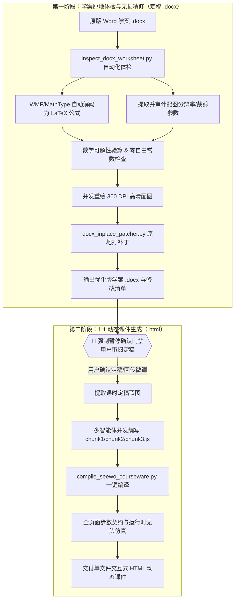

# 初中数学学案无损优化与交互式 HTML 动态讲解课件（希沃大屏版）全流程开发工具链

[](LICENSE)
[](https://www.python.org/)
[]()

> 本项目是一套专门面向**初中数学课堂教学、希沃（Seewo）白板大屏、Pad 触屏交互**的工业级学案优化与动态课件全自动化开发流水线。
> 实现了从**原版 Word 学案原地无损精修（In-Place XML Patching）**到**单文件高帧率、纯原生、零剧透的交互式 HTML 动态讲解课件**的端到端生产闭环。

---

## 目录
- [一、核心架构与最新生成流程（SOP）](#一核心架构与最新生成流程sop)
  - [阶段一：学案体检与无损精修（.docx）](#阶段一学案体检与无损精修docx)
  - [阶段二：基于定稿学案 1:1 编译动态课件（.html）](#阶段二基于定稿学案-11-编译动态课件html)
- [二、课件 5 大自适应页面版式（Layouts A–E）](#二课件-5-大自适应页面版式layouts-ae)
- [三、波利亚级（Polya-Grade）SVG 动态标注规范](#三波利亚级polya-grade-svg-动态标注规范)
- [四、零剧透与课堂教学节奏控制铁律](#四零剧透与课堂教学节奏控制铁律)
- [五、配套工具链与脚本使用说明](#五配套工具链与脚本使用说明)
- [六、目录结构索引](#六目录结构索引)

---

## 一、核心架构与最新生成流程（SOP）

为彻底解决“边改学案边猜着写课件”导致的题干不一致、字母错位、设问脱节与反复返工问题，本项目严格执行**“两阶段用户确认制 SOP（Two-Stage Confirmation SOP）”**：



### 阶段一：学案体检与无损精修（.docx）
1. **自动化体检与公式解码**：
   - 运行 `inspect_docx_worksheet.py`，全自动扫描文档结构；
   - 彻底解码遗留 MathType `<w:object>`（WMF 矢量碎片）与原生 `<m:oMath>`，转换为内联 `$LaTeX$` 公式；
   - 过滤公式垃圾切片，仅导出真正的几何/函数配图，审计物理尺寸与 `<a:srcRect>` 裁剪边界。
2. **数学可解性与几何零自由常数铁律（Mathematical Solvability）**：
   - 严禁随意设定无约束常数坐标；
   - 除动点（如 $A(x_0, k/x_0)$）外，垂足、交点、对称点坐标必须严格由已知条件方程推导计算；
   - 严格进行代数消元检验（确保所求面积/线段无无法消除的未知变量）；
   - 题干几何名称与图形顶点字母必须 100% 严格一致。
3. **原地无损 XML 修补（In-Place XML Patching）**：
   - 严禁丢弃模板重新生成 docx。调用 `docx_inplace_patcher.py` 定点替换 `word/document.xml`；
   - 100% 保留页面边距、抬头页眉、四号（12pt）字号、1.5倍行距；
   - 彻底清空 `<mc:AlternateContent>` 浮动圆角归纳框下方被遮挡的废弃模板残留段落，同步更新 DrawingML 与 VML 双分支。
4. **🛑 强制确认门禁**：
   - 交付 `xxx_学生学案_优化版.docx` 及清单，明确向用户确认：“请确认学案是否定稿，确认后将 1:1 生成对应 HTML 课件”。

### 阶段二：基于定稿学案 1:1 编译动态课件（.html）
1. **锁定唯一真实数据源（Single Source of Truth）**：
   - 以定稿学案中的题干、设问、字母和配图为唯一基准，严禁脱离学案自由发挥。
2. **模块化分块编写（Parallel Chunk Builders）**：
   - 将课件划分为 3 个模块并行编写：
     - `chunk1_intro_explore.js`：情境引入与新知探究；
     - `chunk2_apply.js`：新知应用与典例精析；
     - `chunk3_train_summary.js`：分层训练与课堂小结。
   - 统一调用壳层规范：`window.defineSlide({...})`、`window.createCoordCanvas({...})`、`window.renderMultiPanelScene(step, panels)`。
3. **一键编译与严苛门禁检测**：
   - 运行 `compile_seewo_courseware.py`，执行以下门禁检测：
     - 语法树扫描与括号平衡；
     - 步数契约检验（`.step` 卡片数必须严格等于进度圆点数，且 $\ge$ 填空最大 `data-step`）；
     - DOM 树合规性校验（禁止非法嵌套 `<svg>`，防止样式污染）；
     - `<foreignObject>` 与 `<text>` 几何包围盒零碰撞防压线算法；
     - 0 到 `maxStep` 完整生命周期无头运行时仿真。

---

## 二、课件 5 大自适应页面版式（Layouts A–E）

为适配希沃一体机（16:9，推荐标准画布 1600×900）以及平板触控，课件内置 5 种响应式页面版式：

| 版式类型 | 适用题型与场景 | 页面结构与设计规范 |
| :--- | :--- | :--- |
| **版式 A (`layout-a`)** | **纯代数运算、概念辨析、无配图题** | **100% 全宽流式居中**：无右侧图形区，推导步骤卡片居中展示，字号适度放大，保证后排学生清晰可见。 |
| **版式 B (`layout-b`)** | **单配图几何/函数探究、综合大题** | **严格黄金分割“左解右图”**：左侧 `.screen-notes` 纵向流式排布步骤卡片，右侧 `.screen-media` 全高展示动态交互坐标系或几何图形。 |
| **版式 C (`layout-c`)** | **含 4 个图象选项的选择题** | **上题干与选项图矩阵 + 下解析**：顶部展示题干及一行 4 张高清晰度 SVG 图象卡片，支持点击选项即时判定，下方展示分步排除推导。 |
| **版式 D (`layout-d`)** | **列表—描点—连线作图探究题** | **上表格 + 左下解析 + 右下交互坐标系**：顶部展示标准取点表格，点击“下一步”时数值动态填入，右侧坐标系同步完成“描点 $\to$ 平滑曲线连接”。 |
| **版式 E (`layout-e`)** | **多点坐标验算/卡片翻转题** | **上题干 + 下多卡片网格**：下方并列展示待验算点卡片，跟随步骤逐张翻开并高亮判定结果。 |

---

## 三、波利亚级（Polya-Grade）SVG 动态标注规范

课件中的几何图形完全采用原生高保真 SVG 动态生成，达到与出版级纸质讲义一致的清晰度与专业度：

1. **顶部通栏色彩图例条（`window.svgLegendBar`）**：
   - 凡涉及辅助线、特殊角弧、相似/全等阴影，画布顶部（$y=6\sim 36$）统一渲染浅灰圆角图例条；
   - 严禁在图形角落堆叠大块悬浮卡片遮挡几何边线，严禁在底部放置遮挡顶点的图注标题。
2. **数字角（`1, 2, 3, 4, 5`）图文联动（`window.svgNumberedAngle`）**：
   - 严禁绘制无文字空角弧，严禁使用冗长的三字母角名（如 $\angle DAH$）；
   - 统一在角平分线处以纯数字 $\angle 1, \angle 2, \dots$ 标注；
   - 共顶点相邻角采用**阶梯递增半径**（如 $r = 26, 33, 40$）错开；狭窄角自动开启 `leader: true` 细引线；
   - 左侧推导卡片 100% 同步使用 $\angle 1 = \angle 2$ 书写推导。
3. **求解目标引线气泡框（`window.svgCalloutTag`）**：
   - 在所求目标线段或角旁，采用带圆点引线的圆角标签框标注；
   - 推导中途显示绿底白字 `求 BC = ?`，最终步（`step === maxStep`）高亮切换为红底白字 `BC = 4√3`。
4. **全等/等腰双重标注**：
   - 相等边长必须标注法向垂直短杠（第一组标 `/`，第二组标 `//`）；
   - 已知边长及转移后的等量，紧贴线段标出数值（如 `4`）。
5. **视觉渲染层级**：
   $$\text{底层柔和三角形色块} \longrightarrow \text{原题实线与辅助虚线} \longrightarrow \text{角弧/短杠/直角标} \longrightarrow \text{顶层顶点圆点/斜体字母/图例条}$$

---

## 四、零剧透与课堂教学节奏控制铁律

1. **初始状态（`step = 0`）绝对纯净**：
   - 进入页面时，所有推导步骤卡片默认隐藏，填空处保持留白；
   - **坐标系防剧透**：对于原学案无配图、课件补充坐标系的题目，`step = 0` 时右侧**仅展示空白坐标轴与网格**，严禁提前画出双曲线或描出关键点；
   - **几何图防剧透**：`step = 0` 严格还原原题，辅助线与色块在对应步骤触发时动态生长。
2. **定性观察与严禁测量读数（Qualitative Observation Only）**：
   - 滑块（Slider）仅用于**定性拖动观察图形联动变化**（如观察点 $P$ 移动时矩形形态或相似三角形对应关系）；
   - **绝对禁止在滑块旁或画布上输出动态测量数值读数（如 `3.30`）**，避免干扰严谨的几何证明逻辑。
3. **长题与多问拆页规范**：
   - 单页步骤卡片严格控制在 2～3 步；
   - 遇到 $\ge 3$ 个小问或长背景跨学科应用题，必须拆分成连续的独立幻灯片页面（如 `第(1)问` 与 `第(2)问` 分页）；
   - 后续页面顶部统一配置浅蓝底色 `【前问已知】` 提示条承接上下文。

---

## 五、配套工具链与脚本使用说明

### 1. 学案体检与配图审计 (`inspect_docx_worksheet.py`)
```bash
python3 .agents/skills/math-interactive-courseware/scripts/inspect_docx_worksheet.py \
  "path/to/学案.docx" \
  --media-out /tmp/audit_media \
  --json-out /tmp/audit_report.json
```
- 输出全部配图的原始 DPI、物理宽高及裁剪边界。
- 自动解码文档内所有 `<w:object>` 与 `<m:oMath>` 公式。

### 2. 学案原地无损 XML 修补 (`docx_inplace_patcher.py`)
```python
from scripts.docx_inplace_patcher import DocxWorksheetPatcher

patcher = DocxWorksheetPatcher("原学案.docx")
# 定点更新公式、文字、圆角框双分支并清空框下残留
patcher.patch_paragraph(target_index, new_xml_fragment)
patcher.save("优化版学案.docx")
```

### 3. 一键课件编译与自动化仿真 (`compile_seewo_courseware.py`)
```bash
python3 .agents/skills/math-interactive-courseware/scripts/compile_seewo_courseware.py \
  --title "2.2.3 反比例函数中“k”的几何意义" \
  --chunks courseware_2_2_3_build/chunk1_intro_explore.js \
           courseware_2_2_3_build/chunk2_apply.js \
           courseware_2_3_1_build/chunk3_train_summary.js \
  --output "2.2.3_反比例函数中“k”的几何意义_动态讲解课件.html"
```

---

## 六、目录结构索引

```text
├── .agents/skills/math-interactive-courseware/   # 核心技能与流水线定义
│   ├── SKILL.md                                # 官方规范说明书（包含全套规则与契约）
│   ├── layers/                                 # 希沃大屏标准 HTML 壳层
│   │   ├── seewo_shell_prefix.html             # 顶层交互容器、样式表、数学引擎库
│   │   └── seewo_shell_suffix.html             # 播放控制条、快捷键、手写荧光笔
│   └── scripts/                                # 核心自动化编译与修补工具
│       ├── inspect_docx_worksheet.py           # 学案体检与 WMF/OMML 公式解码器
│       ├── docx_inplace_patcher.py             # 原地无损 Word XML 补丁器
│       ├── compile_seewo_courseware.py         # 课件一键编译器与契约门禁仿真器
│       └── audit_figure_script.py              # 配图真实数学坐标与可解性校验器
├── courseware_*_build/                         # 各课时源码分块（chunk1/chunk2/chunk3.js）
├── 数学学案优化与动态交互课件开发规范总结.md        # 历次迭代全量技术总结
└── *.html / *.docx                             # 已发布的标杆课件与对应优化版学案
```

---

## 许可证
本项目遵照 [MIT License](LICENSE) 进行开源与内部技术共享。
