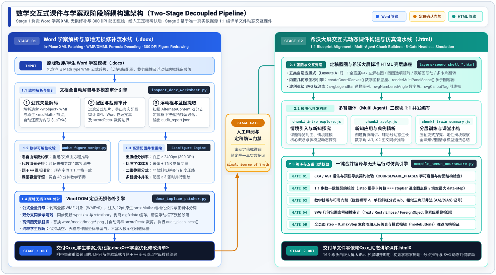

# 数学交互式课件（Math Interactive Courseware）

[](https://github.com/HaoranXIONG-edu/math-interactive-courseware/actions/workflows/verify-courseware.yml)
[](LICENSE)
[](https://www.python.org/)
[]()

> 面向中学数学课堂教学、教室智慧大屏及触屏设备的学案优化与交互式课件构建工具链。支持从 Word 学案原地 XML 无损修补（`.docx`）到单文件 SVG 动态交互课件（`.html`）的标准化构建与校验。

---

## 目录
- [一、系统架构与构建流程](#一系统架构与构建流程)
  - [阶段一：Word 学案解析与无损修补（.docx）](#阶段一word-学案解析与无损修补docx)
  - [阶段二：交互式动态课件构建与校验（.html）](#阶段二交互式动态课件构建与校验html)
- [二、三大核心组件库架构（2024北师大版全六册）](#二三大核心组件库架构2024北师大版全六册)
- [三、示范课例与交互式课件索引](#三示范课例与交互式课件索引)
- [四、自适应页面版式体系（Layouts A–I）](#四自适应页面版式体系layouts-ai)
- [五、几何图示 SVG 动态标注规范](#五几何图示-svg-动态标注规范)
- [六、渐进式呈现与教学节奏控制规范](#六渐进式呈现与教学节奏控制规范)
- [七、工具链接口与命令行使用说明](#七工具链接口与命令行使用说明)
- [八、项目目录结构](#八项目目录结构)

---

## 一、系统架构与构建流程

本项目采用**两阶段解耦构建流程**：先完成 Word 学案的结构解析、配图重绘与 XML 无损修补，经审阅定稿后，再以定稿学案为唯一数据源生成对应的单文件交互式 HTML 课件，确保学案与课件的题干、符号及图形坐标完全一致。

<p align="center">
  
</p>

### 阶段一：Word 学案解析与无损修补（.docx）
1. **文档解析与公式解码**：
   - 运行 `inspect_docx_worksheet.py` 扫描文档 XML 结构；
   - 将遗留 MathType `<w:object>`（WMF 矢量对象）与原生 `<m:oMath>` 自动解码为内联 `$LaTeX$` 表达式；
   - 导出文档内的几何与函数配图，审计原始分辨率、物理尺寸及 `<a:srcRect>` 裁剪参数。
2. **几何坐标推导与可解性校验**：
   - 除自由动点（如 $A(x_0, k/x_0)$）外，垂足、交点、对称点坐标均由题干几何条件对应的代数方程精确计算，不引入无约束常数坐标；
   - 对含参面积或长度问题进行代数消元检验，确保结果唯一可解；
   - 校验题干几何元素名称与配图顶点字母完全对应。
3. **原地无损 XML 修补（In-Place XML Patching）**：
   - 调用 `docx_inplace_patcher.py` 在原文档 `word/document.xml` 上执行定点替换；
   - 完整保留原模板的页面边距、页眉、字号（四号 12pt）与行距（1.5 倍行距）；
   - 同步更新 `<mc:AlternateContent>` 浮动文本框的 DrawingML 与 VML 双分支，并清理文本框下方被遮挡的残留段落。
4. **定稿确认**：
   - 输出 `xxx_学生学案_优化版.docx` 及修订说明，确认定稿后进入课件构建阶段。

### 阶段二：交互式动态课件构建与校验（.html）
1. **数据源对齐**：
   - 以定稿学案中的题干、设问梯度、顶点字母与配图坐标作为唯一基准数据。
2. **模块化脚本编写**：
   - 按教学环节划分为 3 个脚本模块：
     - `chunk1_intro_explore.js`：情境引入与新知探究；
     - `chunk2_apply.js`：新知应用与典例精析；
     - `chunk3_train_summary.js`：分层训练与课堂小结。
   - 统一调用壳层接口：`window.defineSlide({...})`、`window.createCoordCanvas({...})`、`window.renderMultiPanelScene(step, panels)`。
3. **编译与自动化校验**：
   - 运行 `compile_courseware.py` 注入交互壳层并执行自动化校验：
     - JavaScript 语法检查；
     - 步骤一致性校验（`.step` 卡片数与进度圆点数、填空 `data-step` 严格对齐）；
     - DOM 与公式排版校验（根式顶线 `.sqrt`、二维叠置分式 `.fraction`、禁止嵌套 `<svg>`）；
     - SVG 文本与图形包围盒防重叠碰撞检测；
     - 全页面 `0..maxStep` 步进状态无头运行时仿真。

---

## 二、三大核心组件库架构（2024北师大版全六册）

课件底层已全面解耦为**三大独立核心组件库**（并提供合并运行时 `courseware_components.js` 与在线交互预览页 [docs/component_library_preview.html](docs/component_library_preview.html)），完整覆盖 2024 版北师大初中数学七至九年级全六册教材场景：

| 组件库模块 | 源码路径 | 核心子模块与 API | 核心能力说明 |
| :--- | :--- | :--- | :--- |
| **1. 数学公式与图形组件库**<br>*(Math Component Library)* | [`components/math_components.js`](components/math_components.js)<br>[`layers/math_components.js`](.agents/skills/math-interactive-courseware/layers/math_components.js) | • `MathFormula.render()` / `.svg()`<br>• `createGeoCanvas()`<br>• `createFuncCanvas()`<br>• `createNumberLine()` / `createBoxPlot()`<br>• `create3DCanvas()` | • **M1 公式引擎**：自动中西文正斜体切分、连体矢量根号 $\sqrt{\quad}$、顶弧 $\overset{\frown}{AB}$、嵌套分式方程组、SVG 无胶囊白描边直接旁注<br>• **M2 平面几何画板**：波利亚阶梯数字角（$\angle 1, \angle 2$）、切线/圆弧尺规作图痕迹、将军饮马轴对称变换、通栏图例条<br>• **M3 函数画板**：一次/二次/反比例函数、对称轴、二次函数铅垂高 $\triangle PAB$ 智能阴影与旁注<br>• **M4/M5 统计与立体**：北师大标准单箭头数轴不等式解集、统计箱线图、正方体截面与圆锥侧面展开图 |
| **2. 页面 UI 与教学交互组件库**<br>*(Page UI Component Library)* | [`components/ui_components.js`](components/ui_components.js)<br>[`layers/ui_components.js`](.agents/skills/math-interactive-courseware/layers/ui_components.js) | • `UI.bookBadge()` / `UI.prevContext()`<br>• `UI.stemCard()` / `UI.blank()` / `UI.choices()`<br>• `UI.stepCard()`<br>• `UI.stepTable()` / `UI.summaryGrid()` | • **U1 教材栏目与承接**：还原2024版北师大教材《尝试·思考》《操作·思考》《随堂练习》徽章与拆页`【前问已知】`横幅<br>• **U2 零剧透题干与填空**：支持单步点击揭晓或随步骤自动填入题干下划线填空与选择题选项网格<br>• **U3 波利亚步骤卡片**：内置 `[导角]`、`[表边]`、`[求解]` 色彩动作标签与 1:1 渐进式折叠引导条<br>• **U4 取点表与总结网格**：描点法动态表格揭晓与双栏核心模型对照卡片 |
| **3. 课堂黑板批注与尺规作图库**<br>*(Ink & Geometry Annotation)* | [`components/annotation_components.js`](components/annotation_components.js)<br>[`layers/annotation_components.js`](.agents/skills/math-interactive-courseware/layers/annotation_components.js) | • `InkAnnotationLayer.createInteractiveDemo()`<br>• `InkAnnotationLayer.setupCoursewareToolbar()`<br>• `traceShapePath()` / `traceBezierPath()`<br>• `getAxesHandles()` / `applyAxesHandleDrag()` | • **A1 悬浮批注坞**：支持按住左侧手柄 `⠿` 或空白处**自由拖拽移动位置**，支持点击右侧 `—` **一键最小化收起为悬浮球**（避免遮挡底层数轴/图形）<br>• **5 大课堂批注工具**：触控穿透点击、二次贝塞尔平滑画笔、底层正片叠底荧光笔、块状橡皮擦、撤销/重做/清屏<br>• **8 种数学专属尺规作图**：平面直角坐标系 $xOy$（**拖出后支持单独拉动四端手柄调节 $+x, -x, +y, -y$ 各半轴长度及平移原点 $O$**）、带刻度数轴、$\triangle$、$\text{Rt}\triangle$（自动带直角标）、$\odot$、矩形、实/虚辅助线、箭头 |

> 💡 **在线预览演练场**：直接打开 [`docs/component_library_preview.html`](docs/component_library_preview.html) 即可在浏览器中交互式体验全部三大组件库、切换讲解步进状态（`step=0` 零剧透 $\leftrightarrow$ `step=4` 完整展开）并在黑板演练场中拖拽坐标系半轴手柄或测试批注栏折叠。

---

## 三、示范课例与交互式课件索引

仓库内置 **5 节完整示范课例（共 68 页交互式幻灯片）**、**1 个三大核心组件库全景演练场** 与 **1 个 AI 试卷讲评工作台原型**，全部通过五重门禁无头仿真校验。可直接打开根目录 [index.html](index.html) 门户页浏览，或点击下表快速访问对应文件：

| 序号 | 课题 / 模块名称 | 幻灯片数 | 适用版式与核心特性 | 动态讲解课件（`.html`） | 优化版学生学案（`.docx`） |
| :---: | :--- | :---: | :--- | :--- | :--- |
| **00** | **三大核心组件库架构总览与交互演练场** | 组件库全景 | 数学公式与图形库 + 页面 UI 库 + 可拖拽/最小化尺规批注画板 | [component_library_preview.html](docs/component_library_preview.html) | [图示标注规范.md](docs/图示标注规范.md) |
| **01** | **2.2.2 反比例函数的图象（2）** | 15 页 | `Layouts A/B` · 双曲线增减性、跨象限三点比较三法切换 | [2.2.2_动态讲解课件.html](lessons/2.2.2_反比例函数的图象（2）/2.2.2_反比例函数的图象（2）_动态讲解课件.html) | [2.2.2_学生学案_优化版.docx](lessons/2.2.2_反比例函数的图象（2）/2.2.2_反比例函数的图象（2）_学生学案_优化版.docx) |
| **02** | **2.2.3 反比例函数中“k”的几何意义** | 16 页 | `Layouts A/B` · 面积定值模型、同底等高转化、多子图联动 | [2.2.3_动态讲解课件.html](lessons/2.2.3_反比例函数中“k”的几何意义/2.2.3_反比例函数中“k”的几何意义_动态讲解课件.html) | [2.2.3_学生学案_优化版.docx](lessons/2.2.3_反比例函数中“k”的几何意义/2.2.3_反比例函数中“k”的几何意义_学生学案_优化版.docx) |
| **03** | **2.3.1 反比例函数的应用（1）** | 18 页 | `Layouts A/B/D` · 列表描点拟合、压强/杠杆跨学科建模 | [2.3.1_动态讲解课件.html](lessons/2.3.1_反比例函数的应用（1）/2.3.1_反比例函数的应用（1）_动态讲解课件.html) | [2.3.1_学生学案_优化版.docx](lessons/2.3.1_反比例函数的应用（1）/2.3.1_反比例函数的应用（1）_学生学案_优化版.docx) |
| **04** | **2.3.2 反比例函数的应用（2）** | 11 页 | `Layout B` · 一次与反比例交点、三垂直分界与平行四边形探究 | [2.3.2_动态讲解课件.html](lessons/2.3.2_反比例函数的应用（2）/2.3.2_反比例函数的应用（2）_动态讲解课件.html) | [2.3.2_学生学案_优化版.docx](lessons/2.3.2_反比例函数的应用（2）/2.3.2_反比例函数的应用（2）_学生学案_优化版.docx) |
| **05** | **第20题 十字双垂旋转模型** | 8 页 | `Layout B` · 波利亚四步法、通栏图例、数字角与二维分式 | [第20题_动态讲解课件.html](lessons/第20题_十字双垂旋转模型/第20题_十字双垂旋转模型_动态讲解课件.html) | —（专项几何压轴精讲） |
| **06** | **One·ai 试卷讲评工作台（演示）** | 交互工作台 | 班级得分率热力分布、学生真实作答对比、典型错因归因 | [One·ai_讲评工作台_动态演示.html](workbench_demo/One·ai_讲评工作台_动态演示.html) | —（智慧讲评工作台原型） |

---

## 四、自适应页面版式体系（Layouts A–I）

为适配教室一体机大屏（16:9，推荐标准画布 1600×900）以及平板触控，课件内置 **1 种标准教学封面 + 9 种自适应页面版式**（完整配置模板见 [`LAYOUTS.md`](.agents/skills/math-interactive-courseware/LAYOUTS.md)），覆盖“新知归纳、例题精讲、图表探究、多解对比、方法汇总、课堂小结”全教学环节：

| 版式类型 | 适用题型与场景 | 页面结构与设计规范 |
| :--- | :--- | :--- |
| **版式 A (`layout-a`)** | **纯代数运算、概念辨析、无配图题** | **100% 全宽流式居中**：无右侧图形区，推导步骤卡片居中展示，字号适度放大，保证后排学生清晰可见。 |
| **版式 B (`layout-b`)** | **单配图几何/函数探究、综合大题** | **严格黄金分割“左解右图”**：左侧 `.screen-notes` 纵向流式排布步骤卡片，右侧 `.screen-media` 全高展示动态交互坐标系或几何图形。 |
| **版式 C (`layout-c`)** | **含 4 个图象选项的选择题** | **上题干与选项图矩阵 + 下解析**：顶部展示题干及一行 4 张高清晰度 SVG 图象卡片，支持点击选项即时判定，下方展示分步排除推导。 |
| **版式 D (`layout-d`)** | **列表—描点—连线作图探究题** | **上表格 + 左下解析 + 右下交互坐标系**：顶部展示标准取点表格，点击“下一步”时数值动态填入，右侧坐标系同步完成“描点 $\to$ 平滑曲线连接”。 |
| **版式 E (`layout-e`)** | **多点坐标验算/卡片翻转题** | **上题干 + 下多卡片网格**：下方并列展示待验算点卡片，跟随步骤逐张翻开并高亮判定结果。 |
| **版式 F (`layout-f`)** | **知识归纳与流程对照（新授课）** | **含 `example`**：顶部例题横幅 + 水平“左通法要领 $\leftrightarrow$ 右同步演算”一一对应对照行；**无独立 `example`**：居中 PPT 风格主题顶栏知识卡。 |
| **版式 G (`layout-g`)** | **一题多解对比 / 正误辨析** | **2/3 列自适应高度居中对比卡**：支持 `badge`（`✓ 推荐` / `⚠ 易错`）、完整解题过程 + 步进点评区（`comment`，23px）及末步揭晓的底部 `summary` 总结条。 |
| **版式 H (`layout-h`)** | **教研级交互对比表格** | **蓝白渐变表头 + 顶对齐单元格**：首列彩色方法胶囊保留提示，其余列随步进逐行揭晓，底部支持 `summary` 选用策略条。 |
| **版式 I (`layout-i`)** | **全屏居中交互式思维导图 / 课堂小结** | **100% 全宽原生 SVG 思维导图**：调用 `window.renderMindMapScene` 渲染中心主题 $\to$ 彩色分支 $\to$ 子节点 $\to$ 核心解读框，支持点击分支展开与底部 `summary`。 |

---

## 五、几何图示 SVG 动态标注规范

课件中的几何图形完全采用原生高保真 SVG 动态生成，达到与出版级纸质讲义一致的清晰度与专业度：

1. **顶部通栏色彩图例条（`window.svgLegendBar`）**：
   - 凡涉及辅助线、特殊角弧、相似/全等阴影，画布顶部（$y=6\sim 36$）统一渲染浅灰圆角图例条；
   - 严禁在图形角落堆叠大块悬浮卡片遮挡几何边线，严禁在底部放置遮挡顶点的图注标题。
2. **数字角（`1, 2, 3, 4, 5`）图文联动（`window.svgNumberedAngle`）**：
   - 严禁绘制无文字空角弧，严禁使用冗长的三字母角名（如 $\angle DAH$）；
   - 统一在角平分线处以纯数字 $\angle 1, \angle 2, \dots$ 标注；
   - 共顶点相邻角采用**阶梯递增半径**（如 $r = 26, 33, 40$）错开；狭窄角自动开启 `leader: true` 细引线；
   - 左侧推导卡片 100% 同步使用 $\angle 1 = \angle 2$ 书写推导。
3. **求解目标引线气泡框（`window.svgCalloutTag`）**：
   - 在所求目标线段或角旁，采用带圆点引线的圆角标签框标注；
   - 推导中途显示绿底白字 `求 BC = ?`，最终步（`step === maxStep`）高亮切换为红底白字 `BC = 4√3`。
4. **全等/等腰双重标注**：
   - 相等边长必须标注法向垂直短杠（第一组标 `/`，第二组标 `//`）；
   - 已知边长及转移后的等量，紧贴线段标出数值（如 `4`）。
5. **视觉渲染层级**：
   $$\text{底层柔和三角形色块} \longrightarrow \text{原题实线与辅助虚线} \longrightarrow \text{角弧/短杠/直角标} \longrightarrow \text{顶层顶点圆点/斜体字母/图例条}$$
6. **图内公式二维上下叠置分式规范（严禁单行斜杠 `/` 拼凑）**：
   - 设元边长（如 $NF = \frac{4}{3}(4-x)$、$BF = \frac{25-4x}{3}$）及模型比例（$\frac{PF}{PE} = \frac{4}{3}n$），一律调用 `window.svgFoLabel` 或在 `<foreignObject>` 中以 `.fraction` 渲染标准叠置分式，严禁在 `<text>` 中单行裸写 `4/3(4-x)` 或 `(25-4x)/3`；
   - 编译脚本内置 `BARE SLASH FRACTION IN SVG TEXT DETECTED` 语法门禁进行强制校验拦截。

---

## 六、渐进式呈现与教学节奏控制规范

1. **初始状态（`step = 0`）留白控制与「✎ 留白板书」模式**：
   - 进入页面时，所有推导步骤默认折叠为紧凑内联胶囊条（仅显示 `01 展开第 1 步 ▸`，隐藏括号内方法提示以防对学生产生剧透暗示），填空处保持留白；
   - 点击顶部控制栏 `✎ 留白板书`（`board-blank-mode`）可一键隐藏所有未展开步骤占位条，释放 100% 纯净空白区域供教师现场手写板书与批注；
   - **坐标系初始状态**：对于原学案无配图、课件补充坐标系的题目，`step = 0` 时右侧**仅展示空白坐标轴与网格**，严禁提前画出双曲线或描出关键点；
   - **几何图初始状态**：`step = 0` 严格还原原题，辅助线与色块在对应步骤触发时动态生长。
2. **定性观察与禁用动态测量读数（Qualitative Observation Only）**：
   - 滑块（Slider）仅用于**定性拖动观察图形联动变化**（如观察点 $P$ 移动时矩形形态或相似三角形对应关系）；
   - **绝对禁止在滑块旁或画布上输出动态测量数值读数（如 `3.30`）**，避免干扰严谨的几何证明逻辑。
3. **长题与多问拆页规范**：
   - 单页步骤卡片严格控制在 2～3 步；
   - 遇到 $\ge 3$ 个小问或长背景跨学科应用题，必须拆分成连续的独立幻灯片页面（如 `第(1)问` 与 `第(2)问` 分页）；
   - 后续页面顶部统一配置浅蓝底色 `【前问已知】` 提示条承接上下文。

---

## 七、工具链接口与命令行使用说明

### 1. 全仓课例一键编译与五重门禁校验 (`scripts/build_all.py`)
```bash
python3 scripts/build_all.py
```
- 自动遍历全部 5 节示范课例，合并编译 JS 模块并执行五重门禁（语法、步数契约、数学符号、SVG 零碰撞、无头运行时仿真）全量验证。

### 2. 学案结构解析与配图审计 (`inspect_docx_worksheet.py`)
```bash
python3 .agents/skills/math-interactive-courseware/scripts/inspect_docx_worksheet.py \
  "path/to/学案.docx" \
  --media-out /tmp/audit_media \
  --json-out /tmp/audit_report.json
```
- 输出全部配图的原始 DPI、物理宽高及裁剪边界。
- 自动解码文档内所有 `<w:object>` 与 `<m:oMath>` 公式。

### 3. 学案原地无损 XML 修补 (`docx_inplace_patcher.py`)
```python
from scripts.docx_inplace_patcher import DocxWorksheetPatcher

patcher = DocxWorksheetPatcher("原学案.docx")
# 定点更新公式、文字、圆角框双分支并清空框下残留
patcher.patch_paragraph(target_index, new_xml_fragment)
patcher.save("优化版学案.docx")
```

### 4. 单课例课件编译与自动化仿真 (`compile_courseware.py`)
```bash
python3 .agents/skills/math-interactive-courseware/scripts/compile_courseware.py \
  --title "2.2.3 反比例函数中“k”的几何意义" \
  --chunks "lessons/2.2.3_反比例函数中“k”的几何意义/build/chunk1_intro_explore.js" \
           "lessons/2.2.3_反比例函数中“k”的几何意义/build/chunk2_apply.js" \
           "lessons/2.2.3_反比例函数中“k”的几何意义/build/chunk3_train_summary.js" \
  --output "lessons/2.2.3_反比例函数中“k”的几何意义/2.2.3_反比例函数中“k”的几何意义_动态讲解课件.html"
```

---

## 八、项目目录结构

```text
├── components/                                 # 三大核心组件库顶层源码目录（与 .agents/skills/.../layers 实时同步）
│   ├── math_components.js                      # 【第一库】数学公式引擎与几何/函数/数轴/3D图形组件库
│   ├── ui_components.js                        # 【第二库】页面 UI 设计、北师大教材徽章与渐进步骤组件库
│   ├── annotation_components.js                # 【第三库】课堂黑板批注、可拖拽/最小化工具坞与8种尺规作图库
│   └── courseware_components.js                # 三大核心组件库聚合运行时（供壳层与外部页面一键引入）
├── docs/                                       # 组件库预览、技术规范与开发总结文档
│   ├── component_library_preview.html          # 三大核心组件库架构总览与交互式黑板演练场（可直接打开）
│   ├── 图示标注规范.md                          # 数学公式、函数画板与几何动态标注规范细则
│   ├── 数学学案优化与动态交互课件开发规范总结.md  # 双阶段研发全流程总结
│   └── assets/architecture_pipeline.svg        # 双阶段解耦构建架构矢量图
├── .github/workflows/verify-courseware.yml     # GitHub Actions 五重门禁自动化 CI 流水线
├── .agents/skills/math-interactive-courseware/ # 核心技能、组件底座与构建流水线
│   ├── SKILL.md                                # 规范说明书（全套开发规则与接口契约）
│   ├── LAYOUTS.md                              # 全九大自适应版式（Layouts A–I）速查与配置模板
│   ├── layers/                                 # 教室大屏标准 HTML 壳层与组件底座
│   │   ├── math_components.js                  # 数学公式与图形组件库
│   │   ├── ui_components.js                    # 页面 UI 设计与教学交互组件库
│   │   ├── annotation_components.js            # 课堂黑板批注与尺规作图组件库
│   │   ├── courseware_components.js            # 三大核心组件库聚合文件
│   │   ├── shell_prefix.html                   # 顶层交互容器、样式表、数学引擎与组件底座
│   │   └── shell_suffix.html                   # 播放控制条、快捷键、手写画布与悬浮批注挂载器
│   └── scripts/                                # 核心自动化编译与修补工具
│       ├── inspect_docx_worksheet.py           # 学案结构解析与 WMF/OMML 公式解码器
│       ├── docx_inplace_patcher.py             # 原地无损 Word XML 补丁器
│       ├── compile_courseware.py               # 课件一键编译器与契约门禁仿真器（支持 JXA / Node）
│       └── audit_figure_script.py              # 配图真实数学坐标与可解性校验器
├── lessons/                                    # 分课时学案与动态课件（成品 HTML/DOCX + build 模块源码）
│   ├── 2.2.2_反比例函数的图象（2）/
│   ├── 2.2.3_反比例函数中“k”的几何意义/
│   ├── 2.3.1_反比例函数的应用（1）/
│   ├── 2.3.2_反比例函数的应用（2）/
│   └── 第20题_十字双垂旋转模型/
├── scripts/
│   └── build_all.py                            # 全仓课例一键合并编译与五重门禁校验脚本
├── workbench_demo/                             # One·ai 讲评工作台动态演示与构建脚本
│   ├── One·ai_讲评工作台_动态演示.html
│   ├── build_production_workbench_v4.py
│   └── v4_js_patch.js
├── index.html                                  # 课例门户与 GitHub Pages 在线预览主页
├── requirements.txt                            # Python 运行环境依赖声明
├── LICENSE
└── README.md
```

---

## 许可证
本项目遵照 [MIT License](LICENSE) 进行开源与内部技术共享。
